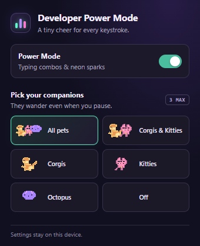
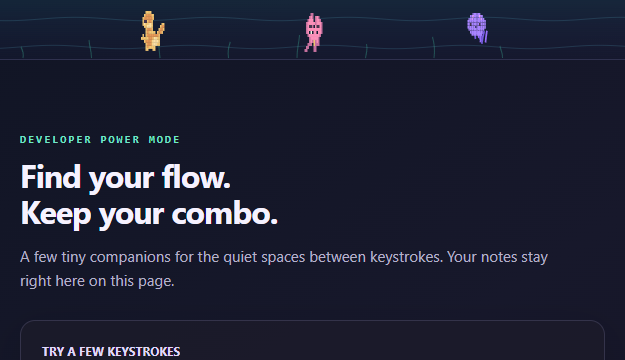
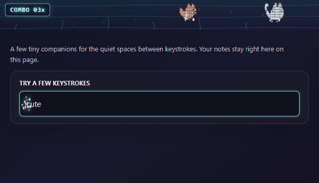

# Developer Power Mode Combo

A local-only Chrome Manifest V3 extension for a small typing-combo counter and
original pixel-art Corgis, Kitties, and Octopuses. Its content script runs on
ordinary HTTP and HTTPS webpages; no build step, account, backend, API key, or
store publication is required.

## Preview







The popup image and animated preview were captured in a local browser from the
extension's actual popup files and content script. No webpage text or screenshot
is uploaded by the extension.

To try the same content-script visuals locally, open
[`screenshots/preview.html`](screenshots/preview.html) in a browser. This
visual-only page supplies a local Chrome-storage shim and a scratch input; it
does not replace testing the unpacked extension on an HTTP/HTTPS site. Add
`?typing` to the preview URL for the compact typing-and-sparks layout used in
the animated screenshot.

## Install in Chrome

1. Download or clone this folder to your computer.
2. Open `chrome://extensions` in Chrome and turn on **Developer mode**.
3. Choose **Load unpacked** and select this folder (the one containing
   `manifest.json`).
4. On an ordinary HTTP/HTTPS webpage, open the extension popup and choose a pet
   mode. Enable **Power Mode** for the combo counter and typing sparks.

Chrome might request permission to run on HTTP/HTTPS sites. Grant access only
to the sites where you want the extension to appear. To update after changing
local files, click **Reload** on the extension card in `chrome://extensions`.

There is no background worker, remote code, external asset request, analytics,
network endpoint, or typed-content storage. Preferences are saved only in
`chrome.storage.local`.

## Settings

- **Power Mode** enables or disables the typing combo and its sparks; pets run
  independently.
- Choose **All pets**, **Corgis & Kitties**, **Corgis**, **Kitties**, **Octopus**,
  or **Off**. At most three pets are active.
- Octopus and All pets modes add translucent water and swaying seaweed.
- On devices configured for reduced motion, only the static combo counter is
  shown; animated pets, water, sparks, and shake effects are paused.

## Combo behavior and privacy

The counter recognizes confirmed, trusted keyboard edits in ordinary text
inputs (`text`, `search`, `email`, `url`, or `tel`), textareas, and standard
contenteditable elements. It excludes password fields, modifier-key shortcuts,
paste, history edits, IME composition, and programmatic changes. Three edits
trigger neon sparks near the caret; every tenth edit gives the overlay a brief
shake. The combo resets after 1.5 seconds without a qualifying edit or when
focus changes to another editor.

The extension briefly reads an editor's current value only to position a caret
effect; it does not retain, save, log, or transmit typed content. The overlay
is an isolated, click-through canvas and counter; it does not alter page
content. Ambient pets, water, seaweed, and ink stay within the webpage's top
60 pixels (below the browser's tab bar). A single animation loop uses
delta-time movement and renders at up to about 30 FPS; it pauses on hidden
tabs. The overlay is capped at three pets, 24 ink blots, and 150 typing
particles.

Content scripts do not run on Chrome's restricted pages, extension pages, or
other pages Chrome blocks. Custom editors may implement input differently, so
compatibility with every editor is not guaranteed.

## Tests

Node.js 18 or later is recommended. Run the focused tests from this folder:

```powershell
node --test tests\logic.test.js
```

The tests cover supported and excluded editor types, keyboard-edit eligibility,
all six pet modes, and invalid or missing stored preferences.
